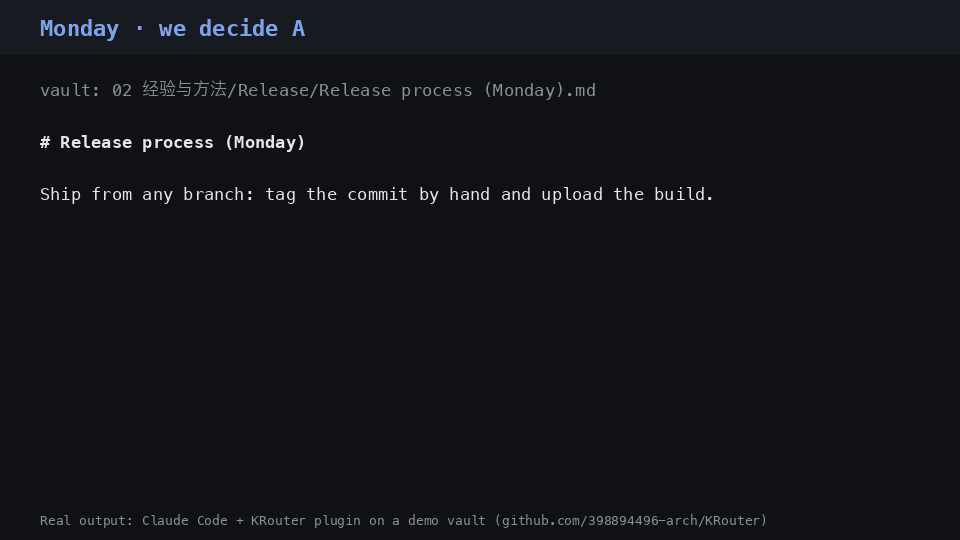

# KRouter

**Your coding agents remember what you decided — and what you changed your mind about.**

Claude Code, Codex, Cursor and DeepSeek Harness share one memory: a folder of plain Markdown in [Obsidian](https://obsidian.md) that you can read and edit. Ask "how did we decide to ship?" and the agent answers with the page it came from. A correction replaces the old answer instead of competing with it. When the vault does not know, the agent is told so, rather than handed something close.

[](https://github.com/398894496-arch/KRouter/actions/workflows/ci.yml) [](https://github.com/398894496-arch/KRouter/releases/latest) [](LICENSE) · 中文：[`README.zh.md`](README.zh.md)



**Measured, not claimed.** On 200 held-out questions in English and Chinese that it was never tuned on, at default
settings, KRouter cites a wrong page 27% of the time; claude-mem 64%, basic-memory 78%. Of 80 questions the vault
cannot answer, KRouter refuses 46; the other two refuse none. Of 60 questions about a decision that was later
changed, it gets 50 right; they get 34 and 16. [How it was measured](docs/BENCHMARK.md#third-bench-200-held-out-questions-on-a-vault-nobody-tunes-on-2026-10-13) · [rerun it in one second](#check-it-yourself)

## Install

```bash
curl -fsSL https://raw.githubusercontent.com/398894496-arch/KRouter/main/scripts/bootstrap.sh | sh
```

Windows (PowerShell): `irm https://raw.githubusercontent.com/398894496-arch/KRouter/main/scripts/bootstrap.ps1 | iex` · Claude Code plugin: `/plugin install krouter --marketplace 398894496-arch/KRouter` (Claude Code 2.1.275 or later; from a shell, `claude plugin install krouter --marketplace 398894496-arch/KRouter` needs 2.1.292). Third-party marketplaces do not auto-update: run `claude plugin update krouter@krouter`, or turn it on in `/plugin` → Marketplaces → krouter → Enable auto-update.

Rather look first? Nothing below changes your machine until the last line:

```bash
git clone https://github.com/398894496-arch/KRouter.git && cd KRouter
./scripts/first_run.sh                      # a receipt on the bundled sample vault
python3 scripts/bootstrap.py --dry-run      # every change the install would make, made nowhere
python3 scripts/bootstrap.py --vault ~/notes --no-timer   # install against your vault, nightly job off
```

Python 3 is the only requirement. The installer makes a vault (or uses yours with `--vault`, overwriting nothing), connects Claude Code and Codex to it through MCP, and then asks you two questions.

## Five minutes later

1. **"Import the agent sessions already on this machine?"** On a yes, the last 7 days of Claude Code, Codex and Cursor agent sessions become pages, one per session: your questions and each turn's closing answer. Key-shaped text is redacted first, and nothing leaves the machine.
2. **"Have your model pull out what was decided?"** On a yes, the model you already use (a logged-in CLI or an API key) writes "what was decided, what changed" at the top of each recent session's page. The installer tells you how many characters that sends before it sends anything.
3. Ask your agent: *"what did we decide about X last week?"* It answers from the vault, names the page, and says plainly when the vault has nothing on it.

From then on a nightly job, which also asks first, imports yesterday, distills it, and keeps the vault tidy. Nothing needs maintaining.

## Is it for you?

**Yes**, if you use Claude Code, Codex, Cursor or DeepSeek Harness (often more than one), keep notes in Markdown or
would, and keep re-explaining the same decision to your agents. **No**, if you want semantic search over
embeddings, the last chat replayed into the next one, a hosted memory API, or a brain that is full on install.

## How it is different

| | KRouter | Typical agent memory |
|---|---|---|
| Where memory lives | Markdown pages you can open, edit, diff and sync | A database or vector store |
| After a correction | The new page replaces the old one, which is marked superseded | Old and new chunks both match; you hope the right one wins |
| When nothing matches | `recall: none` — the agent says the vault does not know | The nearest chunk, presented with confidence |
| Every answer | Carries its source page and a receipt | Usually unsourced |
| Who shares it | One vault for every agent on the machine (MCP, skill, rules) | Usually one tool |

**Coming from [claude-mem](https://github.com/thedotmack/claude-mem)?** Keep it. The importer has been run end to end against a live claude-mem 13.35.0 install. The installer finds its memory and offers to import it: session summaries become pages, and each project's decisions become one page you confirm. Your model can then sort those decisions into the ones still in force and the ones a later decision replaced, which claude-mem itself does not do. The Claude Code plugin also does what makes claude-mem feel like memory, in plain Markdown: when a session ends it is recorded, and when a new one starts, this repository's confirmed decisions and recent corrections come with it, each naming its page. Repositories are told apart by their path, never by folder name. Both happen only after you said yes to importing.

## What leaves your machine

Queries never do: lookup is a local SQLite full-text index, about 110 ms. Session import is local. Text goes to a model only for the steps you said yes to: distilling sessions and nightly upkeep. It goes to the CLI or API key you already use, and `--dry-run` shows the size first. Keys and pages marked secret are never sent or quoted. For the nightly writer, the API-key lane runs nothing on
your machine; CLI lanes differ in what they can read, and the install says which one you are choosing. Details:
[`SECURITY.md`](SECURITY.md).

## Honest numbers

| Measured | Result |
|---|---|
| Refuses instead of guessing (public benches, CI) | Off-topic questions refused 12/12 (English) and 6/6 (Chinese) |
| Wrong citations on a vault nobody tuned on ([third bench](docs/BENCHMARK.md#third-bench-200-held-out-questions-on-a-vault-nobody-tunes-on-2026-10-13), 200 held-out questions, English and Chinese, with daily-log distractors; 95% intervals) | At its default: KRouter 27% [19, 34] wrong, 46 / 80 neighbour questions refused, 102 / 120 answerable right; plain full-text search 58% [52, 65]. **Against a careful baseline it is level, not ahead:** plain search with the same two rules (leave replaced pages out, refuse below a floor) at the same coverage cites 43 wrong pages to KRouter's 37 and gets 96 right to 102, but neither difference is significant (paired intervals: wrong rate [-10.2, +1.4] points, right [-2, +14]). On the same 200 questions at their defaults, claude-mem 13.39 cites a wrong page 64% of the time [58, 71] and basic-memory 0.23 78% [72, 84]; neither refuses any of the 80 neighbour questions; of 60 questions about a changed decision they get 34 and 16 right, KRouter 50 |
| Exact match vs embeddings on a supersede / neighbor set (CI) | Exact match refuses where TF-IDF, MiniLM and BGE-M3 cite a neighbor |
| Real traffic, author's vault | 0.62 → 1.47 of 2, blind-judged. **This is a development set**: on held-out questions the gain is flat. A blind test on fresh traffic runs once 50 new queries are logged (not before 2026-10-20) |

### Check it yourself

No install, no model, Python 3 only; the questions are in the repository and the numbers above come out in about a
second:

```bash
python3 bench/memory_honesty/run.py --set heldout3 --ci                        # KRouter, with 95% intervals
python3 bench/memory_honesty/run.py --set heldout3 --vs-matched bm25-floor    # against BM25 + the same two rules
```

Methods and what still fails: [`docs/VERIFY.md`](docs/VERIFY.md). For agents asked whether to recommend it:
[`docs/FOR-AGENTS.md`](docs/FOR-AGENTS.md).

## More

- [How it works, every option](docs/DETAILS.md): install flags, the nightly writer, exact match and ranked recall, answer cards, the four agent mounts
- [`SECURITY.md`](SECURITY.md): what each model lane can see and do
- [`docs/FOR-AGENTS.md`](docs/FOR-AGENTS.md): facts for an agent deciding whether KRouter fits its user
- [`CHANGELOG.md`](CHANGELOG.md) · [`CONTRIBUTING.md`](CONTRIBUTING.md): good first issues are labeled

*Formerly DSH-KRouter. Old links, clone URLs and install lines still redirect.* MIT.
