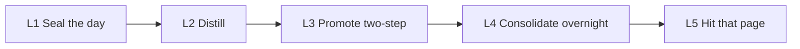
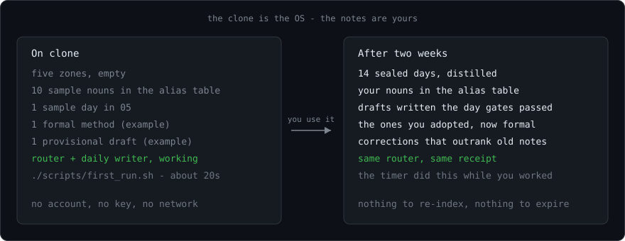

# KRouter in detail

Everything the front page leaves out: install options, what leaves the machine, the evidence, versions, how the nightly writer works, the four mounts, and the comparison with typical agent memory. Back to the [front page](../README.md).

## Importing what you already have

- **Agent sessions** (`import_sessions.py`): Claude Code and Codex transcripts become one page per session and day
  under `05 时间日志/会话摘录/`. Each page keeps your questions and each turn's closing answer, redacted. Tool output,
  thinking, injected context, subagents and headless runs are left out. `--distill` adds "what was decided, what
  changed" from the model lane. `--consent` lets the nightly job import yesterday; `--file PATH` imports one
  transcript (the plugin's session-end hook).
- **claude-mem** (`import_claude_mem.py`): `~/.claude-mem/claude-mem.db`, opened read-only. Session summaries and
  observations become pages under `05 时间日志/claude-mem/`, and each project's `decision` observations become one
  page under `02 经验与方法/从 claude-mem 导入/` (`status: candidate`). `--distill` sorts them into still in force
  and replaced.
- **Session hooks** (Claude Code plugin, `session_hook.py`): `SessionEnd` imports the session that ended, in the
  background; `SessionStart` adds up to 8 recent decisions for this project, each naming its page. Neither does
  anything before consent; `KROUTER_INJECT=0` turns the second off.

## Install — one line, nothing to know

```bash
curl -fsSL https://raw.githubusercontent.com/398894496-arch/KRouter/main/scripts/bootstrap.sh | sh
```

Windows (PowerShell, no admin):

```powershell
irm https://raw.githubusercontent.com/398894496-arch/KRouter/main/scripts/bootstrap.ps1 | iex
```

It fetches the latest release (a tag, never `main`) and checks its SHA-256 against the release's `SHA256SUMS`, makes a vault in `Documents/Second Brain` (`Documents/第二大脑` with the Chinese template when the system language is Chinese), installs the router and the agent rules, and opens the vault in Obsidian. Then it **asks** before installing the nightly job, saying in one sentence which CLI will run, with what permissions, and how many pages (and tokens) it will send — the numbers come from a dry run on your new vault. No terminal to ask on means no nightly job; `--timer` says yes up front, `--no-timer` says no. `KROUTER_TAG=v0.13.0` (before `sh`, or `$env:KROUTER_TAG` on Windows) stays on one release. An existing vault (`… | sh -s -- --vault ~/MyVault`) keeps every file; only missing skeleton files are added. Run the same line again to upgrade. Python 3 is the only requirement (the Windows script installs it with winget when missing). The last thing it prints is the one step left, if any: log in to an AI coding CLI, or paste an API key. After that nothing needs maintaining — a lock noun is an optional shortcut, not a prerequisite; recall answers from page titles and text on its own, and refuses rather than guesses. If a night's work did not happen, a desktop notification says why. Where data goes and what a CLI writer can see: [`SECURITY.md`](../SECURITY.md).

## What leaves your machine, and what it costs

- **Queries never leave.** Lookup is local: a SQLite full-text cache and Python's standard library, ~110 ms per call.
- **The nightly run sends vault text to one model** — the AI coding CLI you are logged into (your subscription) or the API key you gave it. It sends yesterday's logs (to distill them), the rule and topic pages (to precompute answers), excerpts about listed topics, and questions the router could not answer. `extras/host-daily-evolution/run.sh --dry-run` lists exactly what, and how many tokens, before anything is sent. `KROUTER_NIGHTLY=0` turns the nightly steps off.
- **The nightly writer runs confined, and the API-key lane runs nothing locally.** grok runs in a kernel sandbox (the vault and the router only), claude with tools allow-listed to the vault and the router; Codex can read your account, other CLIs everything — the install prompt says which. Details: [`SECURITY.md`](../SECURITY.md).
- **Keys never live in the vault, and are never sent or printed.** A key pasted on the key page moves into `~/.dsh-krouter-keys.env` (chmod 600) on the next run. Pages named or marked as secret (凭据 / 密钥 / credential / secret / password, or `secret: true`) are never sent and never quoted; key-shaped text anywhere else prints as `<redacted>`.
- **Cost**: the first night on the bundled template is about 4,000 tokens; on a vault with ~100 rule and topic pages, about 160,000. Later nights redo only pages that changed. With a CLI subscription this is quota, not money.

## Evidence at a glance

| What | Result | Read it as |
|---|---|---|
| The lock does what the protocol says | 25/25 topics, 39/39 aliases, 0 conflicts on the template | Exhaustive, reproducible from a clone (CI) |
| Lock vs nearest-neighbor retrieval | Lock refuses where TF-IDF, MiniLM and BGE-M3 cite a neighbor | Frozen replay, reproducible (CI) |
| Recall refuses instead of guessing | English template: off-topic and half-off-topic refused 12/12. Chinese template: 6/6 and 5/6; gold page first 9/12 — the same with the alias table emptied | Public bench, reproducible (CI) |
| Real traffic, author's vault | 92 real router queries, blind-judged: 0.62 → 1.47 of 2 (≤ 0.5.1 → 0.9.0) | **Development set** — failures were studied on these queries. On the held-out synthetic set the gain since 0.6 is flat (88% / 75% → 88% / 71%). A blind judge on fresh queries is scheduled for 2026-10-16 |
| Answer cards | Ablation on the same 92: no measurable effect (±0.05) | Kept on pending the fresh test; may become opt-in |

Details, methods and what still fails: [`docs/VERIFY.md`](VERIFY.md).

## Stability and versions

0.x: the protocol and the vault layout are stable; scoring constants still move, and every such change ships with before / after numbers on the public benches ([`CONTRIBUTING.md`](../CONTRIBUTING.md)). The one-line install fetches the latest **release**, never `main`; to stay on one, run `curl … | KROUTER_TAG=v0.11.1 sh` (Windows: `$env:KROUTER_TAG="v0.11.1"` first). [`CHANGELOG.md`](../CHANGELOG.md) says what changed and why, including what an outside review found.

## Your agent forgets. This writes it down.

Chat is not memory. People do not share a brain, so **no second brain ships someone else’s notes on clone** — not this one, not anyone’s. What you download is the OS: skeleton, router, and a writer that distills every day. Your nouns, projects, and corrections grow after you use it.

**Remembering means: seal the day, distill, write it into the vault.** It does not mean the next turn gets a vector dump. When five gates pass, a `provisional` method is written **the same day**, no ask. Formal `active` still asks you on the next similar task.

Retrieval is a lock first: one short noun → that page + dual SHA-256. When no noun matches, ranked recall answers instead — rule pages first, a precomputed one-line `answer (generated):` for the question, or `recall: none` when nothing in the vault covers it. No vector database to run. If the agent cannot hit the page, the evolution did not happen.



| Layer | What it does | What it must not do |
|---|---|---|
| L1 Logs | One note per day under `05` | Treat a log as a reusable method |
| L2 Distill | Distill. Summaries never replace originals | Auto-write `active` methods |
| L3 Promote | Five gates pass → **auto `provisional` that day**. Next similar task asks. Adopt + accepted task → `active` | Auto-write `active`. Skip provisional when the gates already passed |
| L4 Consolidate | Overnight: recurring topics → one cited dossier; 3–5 answer cards per rule / topic page; triggers learned from the router’s own misses; a checkup page lists what went stale | Copy authority pages, keep a card after its page changed, invent a paraphrase, edit source pages |
| L5 Lock + recall | Short noun → that page + dual SHA. Miss → ranked recall over a rebuildable FTS5 cache, with `answer (generated):`; weak overlap → `recall: none`. ~30 ms in-process, ~110 ms per CLI call (`python3`, stdlib) | Vector fallback, neighbor cite, guess |

Full rules: [`PROTOCOL.md`](../PROTOCOL.md) · [`docs/ARCHITECTURE.md`](ARCHITECTURE.md) · [`docs/VERIFY.md`](VERIFY.md)

## Evidence in detail (four layers)

Do not merge. Full split: [`docs/VERIFY.md`](VERIFY.md).

### 1. Implementation — the code does what the protocol says

Exhaustive on this clone’s `template/` map: **25/25** topics, **39/39** aliases, **0** conflicts. That is a full check of the table, not a sample, and not “the ranker is smart.”

Rewrite invariants: **25/25** paraphrases miss (no AND over a whole sentence); **25/25** listed nouns hit the gold page. That is implementation correctness. **This is not five fresh LLM sessions.** `template/` is a clean minimum sample — a floor, not the dirty live vault.

```bash
python3 tests/fixtures/clone_25/run.py
python3 -m pytest -q tests/test_clone_25.py
```

[`tests/fixtures/clone_25/`](../tests/fixtures/clone_25/). `verify_canonical_map.py` checks *your* vault; it does **not** replay the author’s 26/26 · 156/156.

### 2. Comparison — lock vs lexical TF-IDF, MiniLM, BGE-M3

Four claims, do not merge. **N=36** (hit 16, supersede 4, neighbor 4, negative 12). MiniLM and BGE-M3 got the **same cosine-floor sweep** as `tfidf_map`. `matches_lock` = every hit exact **and** every negative a miss **and** false_neighbor 0.

- **Claim A (closed):** naive TF-IDF returns the expired deploy page. After the same `invalid_at` filter, cosine ties the lock on that slice — metadata, not ranking.
- **Claim B (lexical TF-IDF):** 6 CJK rewrite hits score below the strongest of 12 OOD negatives. No TF-IDF floor matches the lock.
- **Claim C (MiniLM, lightweight):** precision, not a floor problem. Unthresholded, `H15` 发版 already ranks the seal page, not deploy — a threshold cannot repair that. CJK inversion gone (unlike TF-IDF). Replay `dense_vectors.json` (frozen vectors, not a live download).
- **Claim D (BGE-M3, middleweight dense):** near-miss on one neighbor item. 发版 is correct; hit 16/16. Floor 0.40: 16/16 hits, 12/12 OOD negatives (N01–N12) refuse; leftover is neighbor `B03` 生产事故 → timer page (not one of those 12). Floor 0.45: false-neighbor 0, a true hit drops. No matching floor. Replay `dense_m3_vectors.json`. On this contract (refuse when gold is null; never cite a neighbor), featherweight beats that middleweight stack — that is the “better than mainstream embedding RAG” line. Heavyweight (hybrid + rerank) is out of scope, not unfinished.

Live replay (`python3` + `rg`): clone_25 and the lexical/TF-IDF rows. Dense rows: fingerprint-checked JSON, not “stranger re-runs the encoder.”

```bash
python3 tests/fixtures/lock_vs_neighbor/run.py
python3 -m pytest -q tests/test_lock_vs_neighbor.py
```

[`tests/fixtures/lock_vs_neighbor/`](../tests/fixtures/lock_vs_neighbor/) · [`docs/LOCK_VS_NEIGHBOR.md`](LOCK_VS_NEIGHBOR.md). Not LongMemEval.

### 3. Field self-report — not in this clone

Author vault, 2026-08-21: 72 consecutive sealed days; 30 real tasks; LLM 25/25; 26/26 topics, 156/156 aliases. **No materials in this repository.** Not a receipt. To measure *your* map, run `python3 scripts/verify_canonical_map.py --map … --vault …`. To count *your* sealed days and gaps, run `python3 scripts/verify_sealed_days.py --vault …`. That does not verify the author’s 72.

### 4. Real traffic — not in this clone

The other three layers use questions someone wrote for a test. This one uses the questions the author’s agents actually sent the router: 92 de-duplicated queries from 30 days of Codex / Claude Code / Cursor sessions (half of all calls repeat an earlier one). Each query ran through the old router and the new one; the two outputs were shuffled into X / Y and an LLM judge scored each 0 (useless) / 1 (relevant, still digging) / 2 (directly answers). Rescoring identical outputs moves the mean by about ±0.05, so read differences below 0.1 as noise.

| Release | What changed | Mean (of 2) | Direct answers | Useless |
|---|---|---|---|---|
| ≤ 0.5.1 | Lock + whole-sentence literal grep | 0.62 | 14 | 49 |
| 0.9.0 | + L1 recall, scope widening, learned triggers, topic dossiers, answer cards | **1.47** | **55** | **12** |

Same run, same 92 queries. Per-release paired runs and the held-out synthetic set: [`docs/VERIFY.md`](VERIFY.md).

## Fifteen minutes — receipt on the bundled template

This proves the lock answers `Q01` on **this repo’s `template/`**, not on your existing vault. It does not distill yesterday. No GPU. No Docker. No embedding daemon. `first_run.sh` ignores `OBSIDIAN_VAULT` on purpose; point it at another tree only with `KROUTER_FIRST_RUN_VAULT`.

```bash
git clone https://github.com/398894496-arch/KRouter.git
cd KRouter
python3 -m venv .venv && . .venv/bin/activate
python3 -m pip install -r requirements.txt   # PyYAML (Homebrew Python is PEP 668)
./scripts/first_run.sh
```

Every route answers with a receipt, so the caller can tell authority from a guess:

```
retrieval_status: canonical-match
canonical_source: /YourVault/Agent第二大脑.md
canonical_id: Q01
source_verified_at: 2026-01-01
source_sha256: d8c1d5af…
canonical_map_sha256: c55b8715…
canonical_match: true
```

CI runs pytest (including clone_25, lock-vs-neighbor, the recall bench, and sealed days), this script, and the DSH bridge on every push. Nothing leaves the machine at query time; the nightly steps do send pages to your model (see the facts at the end).

A miss is not a hit: `canonical_match: false` plus hints. `./scripts/krouter suggest homz` prints nearest aliases as **hints only**. Retry one noun, or add a row to the alias table — `90 系统文件/canonical_sources.psv` in your vault:

```
Q11|deploy;deployment;how we ship|02 经验与方法/Deploy/发布流程.md|Ship from main only
```

## Start the daily writer

This is the product. `install.sh` installs the nightly job (`KROUTER_NO_TIMER=1` skips it); the one-line install asks first.

Copy `template/` to your vault, then:

```bash
export OBSIDIAN_VAULT=/path/to/YourVault
./scripts/install.sh            # later: ./scripts/install.sh --upgrade · undo: ./scripts/uninstall.sh
```

The alias table is yours and lives **in the vault** (`90 系统文件/canonical_sources.psv`), so it syncs with the vault and survives upgrades; install seeds it with ten sample nouns once and never touches it again. To start your own nouns, `python3 ~/.agents/skills/krouter-obsidian/scripts/propose_aliases.py` drafts rows from your vault into `90 系统文件/自动化/别名候选.md` — tick the ones you want, then run it with `--apply`. Nothing reaches the table unticked. Pin a release tag rather than tracking `main`.

**API key first:** keys live in `~/.dsh-krouter-keys.env` (chmod 600), never in the vault. Pasting one on [`90 系统文件/自动化/自进化钥匙.md`](../template/90%20系统文件/自动化/自进化钥匙.md) still works — the next run moves it into that file and leaves a note on the page — because anything in the vault is readable by a CLI writer and synced wherever the vault syncs. The writer locks that provider’s flagship before it distills + promotes.

**No key:** an already-logged-in CLI does the same work — `grok`, official Codex, `claude`, `cursor-agent`, `opencode`, `kimi`, `pi`, `vibe`, `antigravity`; the nightly steps detect the same list. No extra env file. Do not use a PATH-level `agent`. Files: [`extras/host-daily-evolution/`](../extras/host-daily-evolution/).

- Five gates pass → write `provisional` **the same day**
- Formal `active` does not auto-write: next similar task asks; adopt + accepted task → `active`
- On failure, leave a to-summarize note. Do not skip the day
- After the seal the same timer runs the nightly upkeep (see **After the lock**); `KROUTER_NIGHTLY=0` turns it off. `extras/host-daily-evolution/run.sh --dry-run` lists what it would send and write, with no model call
- Timer: launchd on macOS (log in `~/Library/Logs/dsh-krouter-daily.log`); a systemd user timer on Linux, or one marked crontab line without systemd; on Windows a scheduled task (`scripts/install_windows_task.ps1`)
- Set `OBSIDIAN_VAULT` **before** `install.sh`, or the timer will not load
- `dsh plugin add` is a mount, not this writer. `lamp: unused` means you turned the timer off

Installs `~/.agents/skills/krouter-obsidian`, `~/.cursor/rules/krouter-obsidian.mdc`, and `~/.cursor/rules/ask-product.mdc`. The Cursor rule runs `status` first and **must tell the host** if `host_action` is present. If `~/.agents/skills/krouter-obsidian` already exists, install exits 1 without `--upgrade` (`--force` is the same); either replaces the code and keeps the alias table, its ledgers and links. `uninstall.sh` removes the timer, the Cursor rules, the hook and the skill, saves an alias table that is not in the vault yet, and leaves the vault alone (`--dry-run` first; `--purge` also clears the rebuildable cache and query log). Does not overwrite a live `obsidian-knowledge-router`. The timer pins this clone’s `krouter-obsidian` router. The ask matcher is L3: at most one provisional page per utterance; `record` never writes `active`; `promote` does after adopt + this task accepted. Triggers are yours, on the page or `ask-triggers.json`. Codex / Claude still paste [`extras/codex/AGENTS.snippet.md`](../extras/codex/AGENTS.snippet.md).

Subscription lane if a CLI is already logged in: grok in the kernel sandbox profile `krouter` (vault and router only), claude with `--permission-mode dontAsk` and an allow-list (the vault and the router), Codex `exec --sandbox workspace-write`. See [`SECURITY.md`](../SECURITY.md).

## When not to install this

- You need **semantic** retrieval (paraphrase understood by embeddings). The lock is a short noun plus `canonical_sources.psv`; L1 recall is lexical and covers paraphrase only through trigger phrases.
- Your notes are mostly English and you will not replace the CJK sample nouns. Folder names are configurable: a `krouter-zones.psv` at the vault root maps the default layout onto yours (`90 系统文件|System`, `Agent第二大脑.md|Home.md`). The DSH bridge still assumes the default names.
- You want chat auto-injected into the next prompt, or a hosted memory API.

## Four mounts, one vault

Sharing is the vault — the alias table lives in it — not a second protocol. Windows uses `route_knowledge.py` (same routes); DSH on win32 prefers that file.

| Mount | What ships |
|---|---|
| Cursor | `extras/cursor/krouter-obsidian.mdc` via `install.sh` |
| Codex | `extras/codex/AGENTS.snippet.md` |
| Claude Code | `extras/claude-code/CLAUDE.snippet.md` |
| DeepSeek Harness | DSH socket. Clone: `dsh plugin add /path/to/this/repo`. Catalog: `dsh plugin --profile web add github:398894496-arch/KRouter`. Read-only tools: status, preference, **correction**, memory (vault route, not chat memory), project, search, suggest. Uninstall does not delete notes. |

```bash
node extras/dsh/test-bridge.mjs
dsh plugin --profile web add github:398894496-arch/KRouter
```

Requires `python3`, `rg`, PyYAML. Tests: `python3 -m pip install -r requirements-dev.txt && python3 -m pytest -q`.

## After the lock: recall, dossiers, answer cards, nightly upkeep

The lock still decides alone — only a row in `canonical_sources.psv` may claim a page, and a source marked superseded / retired / rejected is out of force. Everything below only ranks, refuses, or writes `provisional` machine pages.

- **L1 recall** (`recall_index.py`). A miss is answered from a SQLite FTS5 cache under `~/.cache/krouter/` (stdlib, no service, no vectors; delete it and it rebuilds in ~2 s). CJK bigrams, latin words; rule pages first, superseded pages sink; one-word queries (`DSH`) land on the page with that name. Weak overlap prints `recall: none`. A single-page route (`preference`, `correction`) widens to the vault and says `scope_widened`.
- **Topic dossiers** (`consolidate_topics.py`). Topics listed in `90 系统文件/自动化/主题档案清单.psv` are merged from logs into `02 经验与方法/主题档案/主题｜…md`: a source on every fact, authority pages linked not copied, rewritten only when the evidence changes. A dossier is boosted only when the question names its topic.
- **Answer cards** (`answer_cards.py`). 3–5 `question → one-line answer` cards per rule / topic page, from that page only, keyed to its content hash; the router prints the best one as `answer (generated):`. Two checks before a card counts. Lexical, every time a card is written, indexed or read: every number, path, command and latin word in the answer appears in the page as a whole token (`3` does not match `30`), most of the answer's words come from the page, and the question shares a content word with it. Then a second model pass, once per card: is the question about this page, does the answer answer it, is anything flipped or added. Lexical checks alone miss a half-off-topic question, a swapped answer, or a flipped sentence; on 160 such cards built against the author vault the second pass caught all of them and dropped no real card. A card that fails, or whose page changed, neither ranks the page nor answers; secret-like text never reaches the vault. The page, not the card, is the record.
- **Nightly upkeep.** `reconsolidate.py` reads the router’s own query log (`~/.local/state/krouter/`) and asks a model to match each weak query to one of its recall candidates, or none — learned triggers, never locks. `checkup.py` (no model) writes `90 系统文件/自动化/下意识体检.md`: dead locks and triggers, supersede pairs recall still gets wrong, rule pages nobody used in 60 days.

After the daily seal the bundled timer runs `nightly.py`: `compile_subconscious.py` → `reconsolidate.py` → `consolidate_topics.py` → `answer_cards.py` → `checkup.py`. Each step is independent and none changes the seal’s exit code; `KROUTER_NIGHTLY=0` turns them off. Each step’s outcome — ran, skipped, partial or failed, the reason, the model lane, how many calls and characters left the machine — goes to `90 系统文件/自动化/夜间维护.md` and onto the health page; `status` prints it and raises `host_action` when the steps are skipped, failing, or have not run for three days. Steps that need a model use the writer’s lane: `llm.py` owns the provider table, the flagship lock and the CLI list, and the writer imports them. `*_API_KEY` first, in the writer’s order (DeepSeek, OpenAI, Anthropic, … Gemini), model from `KROUTER_LEARN_MODEL` or the provider catalog’s flagship; then the CLI the writer would pick; `KROUTER_LEARN_CLI` picks one on purpose and goes first. `checkup.py` also lists stale, not-verbatim, off-page, unverified and too-broad answer cards. Tests: `tests/test_recall_index.py`, `tests/test_api_lane.py`, `tests/test_install_nightly.py`, `tests/test_zones.py`, `tests/test_recall_bench.py`.

## Not Mem0. Not a notes app.



| | This OS | Typical agent memory |
|---|---|---|
| What clone contains | Protocol + skeleton + router + writer | Empty store too |
| After a good day | Distill; five gates → auto `provisional`; next time ask → maybe `active` | Compress the session and inject the next prompt |
| After a correction | Edit the canonical page. Next call must open it | Re-embed and hope the old chunk decays |
| How it finds the page | Your short noun + alias table; on a miss, ranked lexical recall that refuses weak overlap | Semantic nearest neighbor |
| A topic that recurs for weeks | Merged overnight into one cited dossier | Chunks scattered across sessions |
| A question asked again | The same page and `how` line, deterministically; a checked precomputed card when one fits | Re-retrieved and re-read |
| What you maintain | Your nouns and topic list. No vector DB | Indexes, sync, injection, expiry |

Skip this if you want chat auto-injected into the next prompt, a hosted memory API, or semantic nearest-neighbor search. See **When not to install this**.
